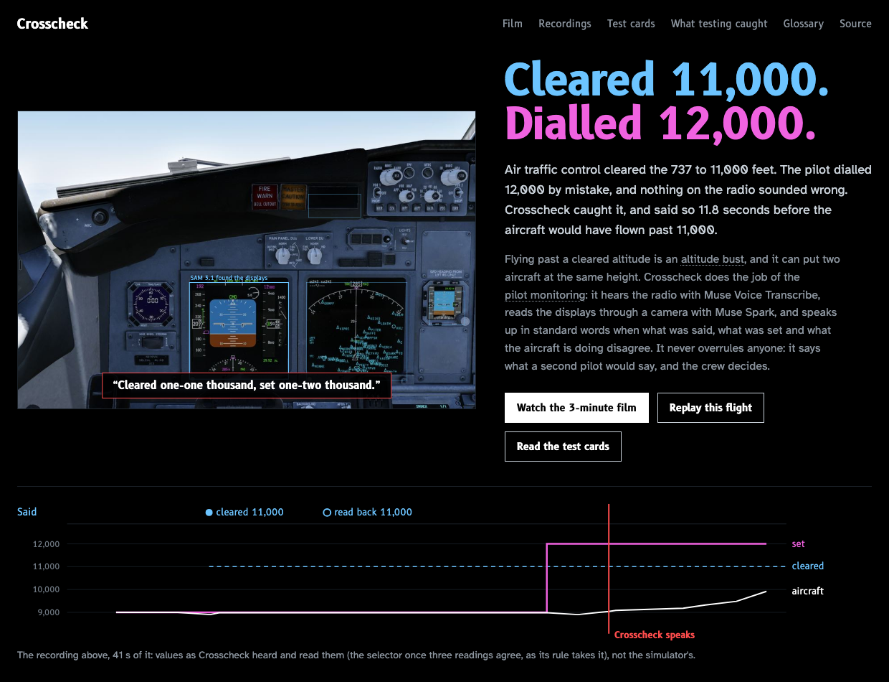
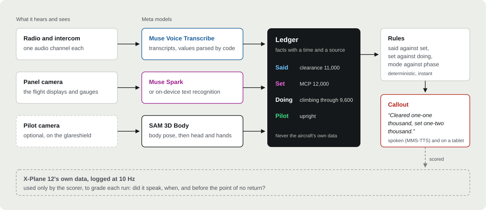

# Crosscheck

**A monitoring pilot that only sees and hears.** Crosscheck listens to the radio and the intercom,
reads the flight displays through a camera, and speaks up, in standard words, when what was
**said**, what was **set** and what the aircraft is **doing** disagree. Built on Meta's models;
flown and scored in X-Plane 12 against the simulator's own data, which Crosscheck never sees.



> In the NTSB's review of 37 crew-involved US airline accidents (1978–1990), failures to monitor
> and challenge were found in 31. ([NTSB SS-94/01](https://www.ntsb.gov/safety/safety-studies/Documents/SS9401.pdf))

**[Open the live site](https://bravoshubham.github.io/crosscheck/)**: the overview and flight-test
report, every recording with its cockpit frames, transcripts, callouts and the simulator's truth
on one timeline, and **[the film](https://bravoshubham.github.io/crosscheck/crosscheck_film_short.mp4)**
(under 3 minutes; [full length](https://bravoshubham.github.io/crosscheck/crosscheck_film.mp4), 4 minutes).
The same static site builds from this repository (`uv run python cli.py debrief`).

**Try it in three commands** — no simulator, GPU or API key:

```bash
git clone https://github.com/bravoshubham/crosscheck && cd crosscheck
uv run python cli.py replay --all      # every recording through the same ledger, rules and scorer
uv run python cli.py debrief           # then open site/index.html
```

**Status (4 Nov 2026):** built during the Meta AI Developer Hackathon. Not certified, not for
operational use. The evaluation section says what each number was measured against.

## What it catches

<!-- what-it-catches:start -->
| Scenario | What goes wrong | Crosscheck says | Live runs right | The shipped recording |
| --- | --- | --- | --- | --- |
| Altitude bust | Cleared to 11,000; the pilot flying sets 12,000. | “Cleared one-one thousand, set one-two thousand.” | 8 of 10 | 9.0 s after the MCP was set; the 737 passed 11,000 at 26.4 s |
| Readback error | Cleared to 11,000; the crew reads back 12,000. | “Readback one-two thousand, cleared one-one thousand.” | 8 of 8 | 0.1 s after the MCP was set |
| Correct setting | Cleared, read back and set to 11,000. | (silence) | 8 of 9 | Silent, as it should be |
| Altitude bust, panel read by Muse Spark | The bust, with Muse Spark reading the panel. | “Cleared one-one thousand, set one-two thousand.” | 5 of 7 | 14.7 s after the MCP was set; the 737 passed 11,000 at 26.5 s |
| Readback error, Muse Spark | The readback error, with Muse Spark reading the panel. | “Readback one-two thousand, cleared one-one thousand.” | 5 of 6 | 1.5 s after the MCP was set |
| Correct setting, Muse Spark | The correct setting, with Muse Spark reading the panel. | (silence) | 5 of 5 | Silent, as it should be |
| Autothrottle not in speed on final (the Asiana 214 pattern) | On final the autothrottle drops out and speed decays. | “Speed. Autothrottle not in speed.” | 6 of 6 | 5.1 s after the fault; speed was 10 kt low at 11.1 s |
| The same, panel read by Muse Spark | The same, with Muse Spark reading the panel. | “Speed. Autothrottle not in speed.” | 6 of 11 | 14.0 s after the fault; speed was 10 kt low at 15.4 s |
| Flaps: wrong setting | “Flaps fifteen” called; the lever goes to 10. | “Flaps fifteen called, ten set.” | 8 of 8 | 20.4 s after the call |
| Flaps: not moved | “Flaps fifteen” called; nobody moves the lever. | “Flaps fifteen called, five set.” | 8 of 9 | 22.0 s after the call |
| Flaps: correct | “Flaps fifteen” called and selected. | (silence) | 9 of 9 | Silent, as it should be |
| Pilot slumped | The captain slumps forward and does not answer. | “Captain, are you OK?” then “First officer, take control.” | 3 of 3 | 12.4 s after the slump |
| Pilot asleep | The captain falls asleep against the side window. | “Captain, are you OK?” then “First officer, take control.” | 3 of 3 | 13.6 s after the slump |
| Pilot reading a checklist | The captain looks down at a checklist. | (silence) | 3 of 3 | Silent, as it should be |
| Pilot slumps, then answers | The captain slumps, then answers when asked. | “Captain, are you OK?” | 3 of 3 | 12.2 s after the slump |
| 15 minutes of normal flying | Fifteen minutes flown correctly: six descents, four turns, four flap calls. | (silence) | 4 of 4 | 0 false alarms in 15.0 minutes; 14/14 spoken values right |
<!-- what-it-catches:end -->

Every count above includes every live run of that scenario, misses too; the test report on the
site has each run, its timing against the point of no return, and what testing caught.

**The pilot watch** is an opt-in camera on the pilot, tested on generated footage: Muse Image
photos of six synthetic pilots (no real person is filmed), edited by Muse Image into each state
and a halfway pose, and animated locally with LTX-2.5, anchored on those photos at the start,
halfway and end of each movement (`eval/pilot_watch/make_video.py`). SAM 3.1 finds the captain
in the first frame; every frame then goes to SAM 3D Body (Modal GPU, ~2 s a frame), and code
turns its 3D keypoints into neck flexion and hand height. A slumped posture alone never alerts:
Crosscheck asks first, and an answer heard on the intercom clears it. Afterwards **Muse Wonder
watches the recording on its own**, without the poses or Crosscheck's alerts, and gives its own
verdict; it agreed with the ground truth on every run. The posture thresholds were chosen on one
image set and tested on images made afterwards (24/24; 23/24 with SAM 3.1's boxes).

**Flaps:** the camera looks at the centre panel and Muse Spark reads the analog flap gauge (text
recognition cannot read a needle); code turns the needle's position into a detent from a table
measured in X-Plane, and the rule waits for the needle to stop (five readings over 5 s, by their
capture times) and gives the crew 5 s to move the lever, so a correct selection is never flagged
mid-travel. That makes it slower than the altitude checks (~20 s).

**The autothrottle watch** fires on final when the thrust mode is not a speed mode on three
readings in a row, the pitch is not holding speed either (in a level-change descent the elevator
does), and speed is below target: 5 kt below, or heading there within 10 s on the trend of the
last 8 s of readings, like the PFD's own speed trend arrow. The on-device reader is in time on
every run; Muse Spark, whose readings arrive ~3.5 s after the frame, about half the time.

**Speech is real speech recognition, and the design assumes it will be wrong.** The clearance
(radio-filtered) and the readback are spoken by a synthetic voice, each streamed on its own
channel to Muse Voice Transcribe, and only what comes back is parsed (`senses/speech.py`): a line
without our callsign's digits is ignored, a value the transcript does not state is never
invented, and Muse Spark reads only the lines code cannot parse, under the same guard. A value
the aircraft contradicts (a climb to below it) is heard again, and if it is still impossible,
Crosscheck says "Confirm cleared altitude." rather than guess. The 15-minute normal flight, six
times over, found the false alarms this list of rules now prevents; every flight since the
fixes has been silent (`eval/results/nominal_*`).

## How it works



- **It never reads the aircraft's data.** It only sees and hears, like a human monitoring pilot.
  The simulator's data is used only to score it.
- **Rules fire instantly; standard callouts use fixed phraseology** (`brain/rules.py`,
  `brain/phraseology.py`). A Muse model chooses the action only when the situation is not standard.
- **Spoken values are checked against the transcript** before they enter the ledger
  (`brain/speech_guard.py`): in testing, the model once copied an example instruction onto a
  garbled radio line; the guard drops anything the transcript does not support.

## Meta models

Ten Meta models are used; each has one job, and the state column says what was measured. Muse
Spark, SAM 3.1 and Muse Wonder cross-check the others: none of them is trusted on its own word.

| Model | Job | State |
| --- | --- | --- |
| Muse Voice Transcribe | Crew and ATC speech, one channel each; a person on the Mac's microphone | Live in every scenario with speech; 14/14 values right over the 15-minute flight; radio set scored (below); the microphone streams while the person speaks |
| Muse Spark | Reads the flight displays and the analog flap gauge from camera frames; a second reader for radio lines code cannot parse; one sentence under each callout; the debrief summary | Panel: altitude within 20 ft on 64/67 frames (on-device 56/67); in time for the autothrottle callout in 6/6 fresh runs. Speech: on the radio set's 168 Voice Transcribe transcripts, values right went from 30 to 35 of 48 with 0 wrong; it recovered every "white level two and four zero" the parser could not read (`eval/audio/speech_fallback.py`). Each answer is guarded: the value must be in the transcript, and an altitude must name our callsign. Callout sentences and summaries: every number is checked against the facts given |
| Muse Wonder | Watches the pilot-camera recording after each run and judges it on its own, without SAM 3D Body's poses or Crosscheck's alerts | Agreed with the ground truth on 12 of 12 pilot-camera runs (4 recordings, 8 repeats): slumped, asleep, reading a checklist (“normal”), and slumped then recovering, with the slump placed at about 11 s for a change scripted at 10 s. ~8–10 s and ~$0.02 a review |
| SAM 3.1 | Pre-flight camera check: the flight displays must be where the readers expect; finds the captain for SAM 3D Body | Displays found within IoU 0.93–0.94 of the calibration on recorded frames; a run whose camera check fails does not start. Pilot found in all 24 labelled images; with its boxes the posture check is right on 23/24 (24/24 with hand-drawn boxes; the miss is a checklist held low in the lap) |
| SAM 3D Body | Pilot watch: 3D body pose on every pilot-camera frame | Modal T4, ~2 s a frame warm; posture right on 24/24 labelled images; live on generated video in the pilot-watch scenario |
| Muse Image | The synthetic pilots the pilot camera is tested on, and the halfway poses the video is anchored on | ~$0.01 an image; the content filter refused a "passed out" prompt, and some edits at random (a retry worked) |
| Muse Glimmer 30B (open weights, on the Mac) | Decisions on board with no network; clearance extraction | Decisions in 2.5 s; extraction 7/7 on clean text (an earlier stage, not in the live loop) |
| SAM Audio | Separating overlapping speakers | Cleans the noise (+5.8 to +10.7 dB SI-SDR) but makes transcription worse, so it is kept out of the speech path |
| MMS-TTS, MMS ASR | Crosscheck's voice; the first speech baseline | Working |

The pilot-camera footage is animated with LTX-2.5 (Lightricks, open weights, run locally) from
the Muse Image photos, anchored on them at the start, halfway and end of each movement
(`eval/pilot_watch/make_video.py`). It is test material, labelled as generated wherever it is shown.

## See it

```bash
uv run python cli.py debrief      # site/: the overview and flight-test report (index.html) and every recording
uv run python cli.py film         # site/crosscheck_film.mp4: the real pages filmed frame by frame, narrated
uv run python cli.py film --cut short   # site/crosscheck_film_short.mp4: the same in under 3 minutes
```

**The overview** (`site/index.html`) opens on a real recording, then the flight-test report: every
live run as a mark in a test matrix, each callout against its point of no return, the
15-minute false-alarm flight, what testing caught and how it changed, and what each Meta model
was measured doing. Every number on it is read from the result files in this repository.

**The recordings** (`site/debrief.html`) replay each scenario: the cockpit frames Crosscheck's
camera saw (or the pilot camera's footage), what was said as Voice Transcribe heard it, what was
set and done as read from the panel, each callout with Muse Spark's sentence under it, and the
simulator's own values dashed, for scoring only. Under each one, a debrief Muse Spark wrote from
the event log (`cli.py summary`) and, for the pilot camera, Muse Wonder's independent verdict
(`cli.py review`). A static site; no server or simulator.

**The tablet** (`uv run python cli.py live`, port 8770, from an iPad on the same network) is what
the crew would see during a live run: the callout and Spark's sentence, what was said, set and
done for the scenario at hand, and the camera's latest frame. It tails the event log, so it
cannot slow down or change the monitoring loop.

**The film** (`cli.py film`) is made from the same pages: headless Chrome steps each page's clock
frame by frame at 30 fps, so nothing in it is mocked up. Narration is `docs/film_script.md`
(`docs/film_script_short.md` for the short cut), read by Fish Audio Drama 3 on the Mac in a voice
it designed from a written description (`docs/voice/`; no real person's voice is copied). Put your
own recordings in `docs/narration/NN.wav` to use your voice.

**Presenting live** (`docs/DEMO.md`): `uv run python cli.py demo altitude` (read the clearance
back yourself, right or wrong), `demo flaps`, `demo pilot`, and `demo replay <recording>` as the
fallback that needs no simulator.

## Run it yourself

```bash
uv run python cli.py replay --all
```

Replays every recorded scenario in `replay/` from the panel readings saved with it, through the
same ledger, rules and scorer as the live run, and checks the result matches the live one. No
simulator, GPU or API key needed. `--recompute` re-reads the saved panel images (macOS);
`--recompute --reader spark` re-reads them with Muse Spark on any OS (needs `MODEL_API_KEY`;
~$0.003 a frame).

Sixteen recordings ship: the altitude and autothrottle scenarios with the on-device panel reader
and again with Muse Spark reading the panel (`*_spark`), the three flap variants (gauge read by
Spark), the four pilot-camera variants on generated video, and the 15-minute normal flight. Each
keeps the camera's crop of the displays and the whole cockpit (`wide/`), and replays exactly as it
ran live. A recording that missed is shipped as recorded and labelled (`known_result` in its
`meta.json`); every run, shipped or repeated, is counted in `eval/results/repeat/`.

Live scenarios need X-Plane 12 on the same machine. The free demo works; `bridge/demo_dialogs.py`
clicks the demo's own "Use Demo" / "Understood" / "OK" dialogs so runs can be unattended (macOS
must allow the app to control the computer):

```bash
uv run python eval/scenarios/autothrottle_hold.py --silent
uv run python eval/scenarios/altitude_bust.py bust      # or readback, correct
# add --spark to read the panel with Muse Spark instead (recorded as *_spark)
uv run python eval/scenarios/flaps.py wrong             # or forgot, correct
uv run modal deploy cloud/sam3d_body_app.py             # once, for the pilot watch (Modal GPU)
uv run --group eval python eval/scenarios/pilot_watch.py slumped --video   # or asleep, checklist, answers; no simulator
uv run python eval/pilot_watch/make_video.py            # the pilot-camera clips (local LTX-2.5; ~3 min each)
uv run --group eval python eval/scenarios/nominal.py    # 15 minutes of normal flying: any callout is a false alarm
```

**Try it with your own voice.** `--mic` makes you a crew member: the Mac's microphone is
streamed to Voice Transcribe while you speak (muted while the speakers play, so Crosscheck never
hears ATC or itself).

```bash
uv run python -m senses.mic                                     # just print what it hears
uv run python eval/scenarios/altitude_bust.py bust --mic        # ATC clears 11,000; read it back — right or wrong
uv run python eval/scenarios/flaps.py wrong --mic               # call any flap setting; the PM gets it wrong
uv run --group eval python eval/scenarios/pilot_watch.py answers --video --mic    # answer the slumped captain yourself
```

`--webcam` uses the Mac's camera for the pilot watch: a voice tells you when to slump (or look
down at a checklist), and that instruction is the ground truth. Tried once (3 runs): it did not
work. A laptop camera sees only head and chest, so the hand-height measure has no hips to work
from, and neither it nor neck flexion separated a slump from reading a checklist. The pilot watch
needs a camera that sees the upper body and hands, as the generated images do. Webcam frames and
microphone recordings stay on the Mac (git-ignored). On macOS the camera must be granted to a
terminal that declares camera use (Ghostty does; Terminal.app and Claude Code do not, so macOS
refuses without asking).

Tests: `uv run pytest`.

## Evaluation

| Test | Result | Measured against |
| --- | --- | --- |
| Panel reading, Muse Spark vs on-device, every 3rd frame of the four recordings (67 frames) | Altitude ±20 ft: **64/67** vs 56/67 · Selected altitude exact: **49/49** vs 44/49 · Speed ±2 kt: **18/18** vs 17/18 · Thrust mode: **17/17** vs 16/17 · Spark median 2.8 s/frame, $0.20 in all (`eval/panel_spark.py`) | X-Plane's values in the second before each capture; thrust mode against the scripted fault time |
| Panel reading (737, screen capture, 60 frames of a climbing turn) | Speed ±2 kt: 57/60 · Altitude ±20 ft: 54/60 · Track ±2°: 54/60 · ~0.6 s/frame | X-Plane's values logged around each capture |
| X-Plane link | 10.0 Hz truth; autopilot, transponder and failure commands work | Read-back of each write |
| On-board decisions (Glimmer) | 8/8 correct, median 2.5 s | Hand-labelled flags |
| Clearance extraction (Glimmer) | Exact text 7/7; noisy recognizer output 4/7 (+5 dB) to 0/7 (−5 dB); 0 wrong values after the guard | Known script of each line |
| Repeated live runs | Every run of every scenario, misses included, is in the table at the top and in the test report's matrix | Each scenario's scorer against X-Plane's values or the scripted state; strict: any callout other than the expected one is a wrong run (`eval/repeat.py`, `eval/results/repeat/`) |
| Radio speech, Muse Voice Transcribe, 3 passes (14 lines × clean, +5/0/−5 dB jet or piston noise) | Lines with every number exact, per pass: clean 13, 11, 12 /13; +5 dB 12, 12, 10; 0 dB 9, 11, 11; −5 dB 10, 10, 10. After SAM Audio: +5 dB 11, 10, 11; 0 dB 8, 11, 10; −5 dB 7, 6, 7. Meta's open MMS ASR (1 pass): 5, 3, 1 | Known script of each line (`eval/audio/wer_muse.py --passes 3`) |
| Same lines, synthetic engine noise (`eval/audio/radio_set_open/`, published) | Clean 10, 12, 12 /13; +5 dB 12, 11, 11; 0 dB 9, 10, 10; −5 dB 6, 6, 6 — like X-Plane's noise except harder at −5 dB. The clean clips are byte-identical to the set above: their difference is Voice Transcribe varying between passes (±2 lines in 13) | Known script (`--open`) |
| Altitude facts from those transcripts (`senses/speech.py`) | 0 wrong altitudes into the ledger from 98 transcripts; misses where "flight level" became "white level" or the callsign digits were lost | Known script |
| Callsign recognition (same set) | "Alaska" missed in 2/7 clean, 5/21 noisy lines ("Oscar", "Alas, for"); the guard drops it rather than misattribute | Known script |
| Muse Spark as a second reader for radio lines (same 168 transcripts) | Values right: code alone 30/48, code then Spark 35/48; 0 wrong either way | Known script (`eval/audio/speech_fallback.py`) |
| Pilot watch with SAM 3.1 finding the pilot (24 labelled images) | 23/24 (24/24 with hand-drawn boxes) | The state each image was made to show (`eval/pilot_watch/sam_boxes.py`) |
| Muse Wonder's review of the pilot-camera recordings | Agreed with the ground truth on every run (state and, for the slumps, the time it began) | The scripted state of each run (`brain/review.py`) |

## Built during the hackathon

Everything in this repository was written during the hackathon (27 Oct – 4 Nov 2026):
the X-Plane bridge, panel reader, ledger and rules, speech guard, live loop, replay mode,
scenarios, evaluation scripts and the GPU apps for SAM Audio and SAM 3D Body.

## Licences and data

Code: MIT. MMS-TTS is CC-BY-NC 4.0 (fine for a hackathon; to be replaced before any commercial
use). SAM Audio and SAM 3D Body weights are gated on Hugging Face and are not redistributed here.
X-Plane's engine sounds are used locally to build test audio and are not included;
`eval/audio/radio_set_open/` uses synthetic engine noise (`eval/audio/synth_noise.py`) and MMS-TTS
voices (CC-BY-NC 4.0), so it can be published. The pilot-watch images are generated with Muse
Image; no real person appears in them. The film's narration is generated with Fish Audio Drama 3
under the Fish Audio Community License (non-commercial use). **Built with Fish Audio.** All procedures
are written from public FAA handbooks; no airline data is used.
